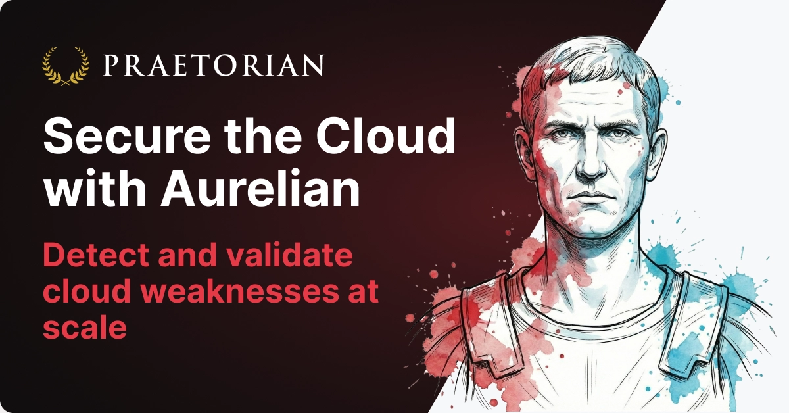

<h1 align="center">Aurelian</h1>

<p align="center">
  <strong>Open-source cloud security reconnaissance framework</strong><br/>
  Detect secrets, misconfigurations, public exposure, and privilege escalation paths across AWS, Azure, and GCP — from a single CLI.
</p>

<p align="center">
<a href="https://github.com/praetorian-inc/aurelian/actions/workflows/ci.yml"></a>
<a href="https://github.com/praetorian-inc/aurelian/releases"></a>
<a href="https://opensource.org/licenses/Apache-2.0"></a>
<a href="https://github.com/praetorian-inc/aurelian/stargazers"></a>
<a href="https://goreportcard.com/report/github.com/praetorian-inc/aurelian"></a>
</p>

<p align="center">
  <a href="#what-is-aurelian">What is Aurelian?</a> •
  <a href="#key-capabilities">Capabilities</a> •
  <a href="#installation">Installation</a> •
  <a href="#quick-start">Quick Start</a> •
  <a href="#modules">Modules</a> •
  <a href="#documentation">Docs</a> •
  <a href="#faq">FAQ</a>
</p>

---

## What is Aurelian?

Aurelian is an open-source, multi-cloud security reconnaissance framework built in Go. It provides a single, unified command-line interface for cloud security assessments across Amazon Web Services (AWS), Microsoft Azure, and Google Cloud Platform (GCP).

Where other tools require you to learn separate workflows per cloud provider, Aurelian gives you **one command structure that works everywhere**: `aurelian [platform] recon [module]`. Each module encapsulates a complex, multi-step security workflow — resource enumeration, content extraction, secrets scanning, policy analysis, access evaluation — behind a single command.

Aurelian was built by the offensive security team at [Praetorian](https://www.praetorian.com), based on years of cloud penetration testing and red team engagements across hundreds of enterprise environments.

### Why Aurelian?

| Challenge | How Aurelian Solves It |
|-----------|----------------------|
| **Fragmented tooling** — different tools per cloud, per task | Unified CLI: same commands, same output across AWS, Azure, and GCP |
| **Complex enumeration workflows** — dozens of API calls for a single finding | Each module orchestrates the full workflow behind one command |
| **Secrets scattered across cloud services** — user data, env vars, configs, logs | `find-secrets` extracts content from 30+ source types and scans with [Titus](https://github.com/praetorian-inc/titus) |
| **Detection during assessments** — CloudTrail logs reveal recon activity | OPSEC-aware techniques minimize logging footprint |
| **Understanding IAM blast radius** — permissions are complex and interconnected | Graph analysis with Neo4j visualizes privilege escalation paths |

---

## Key Capabilities

### Secrets Discovery

Enumerates cloud resources, extracts content from 30+ source types (EC2 user data, Lambda code, CloudFormation templates, CloudWatch logs, ECS task definitions, environment variables, storage blobs, application configurations), and scans with [Titus](https://github.com/praetorian-inc/titus) for hardcoded credentials, API keys, and tokens. Optional validation confirms whether discovered secrets are active.

### Public Resource Detection

Combines resource listing, property enrichment, policy fetching, and access evaluation to identify publicly accessible resources — open S3 buckets, exposed databases, public IPs, anonymous-access storage accounts, and more.

### IAM Privilege Escalation Analysis

Collects IAM data (Get Account Authorization Details, resource policies, org policies), evaluates effective permissions, and detects privilege escalation paths. Outputs JSON or populates a Neo4j graph database for interactive exploration.

### Subdomain Takeover Detection

Checks DNS records in Route53, Azure DNS, and Cloud DNS against known cloud-specific takeover patterns — dangling CNAMEs pointing to unclaimed cloud resources.

### Cloud Misconfiguration Scanning

Azure Resource Graph template-based detection for weak authentication, disabled RBAC, overly permissive access rules, and other configuration issues.

### OPSEC-Aware Reconnaissance

Covert techniques that avoid CloudTrail logging. The `whoami` module identifies the caller ARN using APIs that leak identity in error messages without generating audit log entries.

---

## Supported Cloud Platforms

| Platform | Alias | Modules | Capabilities |
|----------|-------|---------|--------------|
| **Amazon Web Services (AWS)** | `aws`, `amazon` | <!-- autogen:count:aws -->22<!-- /autogen:count:aws --> | Secrets, public resources, IAM graph, subdomain takeover, OPSEC whoami, cost analysis, CDK/CloudFront takeover, enabled-region discovery |
| **Microsoft Azure** | `azure`, `az` | <!-- autogen:count:azure -->8<!-- /autogen:count:azure --> | Secrets, public resources, configuration scan, subdomain takeover, conditional access policies, APIM audit |
| **Google Cloud Platform (GCP)** | `gcp`, `google` | <!-- autogen:count:gcp -->4<!-- /autogen:count:gcp --> | Secrets, public resources, subdomain takeover, resource enumeration |

---

## Installation

### From Source (Recommended)

```sh
git clone https://github.com/praetorian-inc/aurelian.git
cd aurelian
go build -o aurelian main.go
```

Requires **Go <!-- autogen:go-version -->1.27<!-- /autogen:go-version -->+**.

### Docker

```sh
docker build -t aurelian .
docker run --rm -v ~/.aws:/root/.aws aurelian aws recon whoami
```

A `docker-compose.yml` is included with credential volume mounts for all three cloud providers.

### Build Options

```sh
# Standard build
go build -o aurelian .

# SQLite-backed store (for memory-constrained environments)
go build -tags cache_sqlite -o aurelian .
```

---

## Quick Start

### Verify Your Identity (OPSEC-Safe)

```sh
# Identifies caller ARN without CloudTrail logging
aurelian aws recon whoami
```

### Find Hardcoded Secrets

```sh
# Scan all AWS regions for secrets in EC2 user data, Lambda code, CloudWatch logs, and more
aurelian aws recon find-secrets

# Scan Azure subscriptions
aurelian azure recon find-secrets --subscription-ids <id>

# Scan GCP projects
aurelian gcp recon find-secrets --project-id <id>
```

### Detect Public Resources

```sh
# Find publicly accessible AWS resources (S3 buckets, RDS instances, etc.)
aurelian aws recon public-resources

# Azure public resources
aurelian azure recon public-resources --subscription-ids <id>

# GCP public resources
aurelian gcp recon public-resources --project-id <id>
```

### Analyze IAM Privilege Escalation

```sh
# Build IAM graph and detect escalation paths
aurelian aws recon graph --neo4j-uri bolt://localhost:7687

# Offline analysis from GAAD export
aurelian aws analyze analyze-iam-permissions --gaad-file gaad.json
```

### Detect Subdomain Takeovers

```sh
aurelian aws   recon subdomain-takeover
aurelian azure recon subdomain-takeover --subscription-ids <id>
aurelian gcp   recon subdomain-takeover --project-id <id>
```

### List All Modules

```sh
aurelian list-modules
```

---

## Modules

<!-- autogen:modules -->
### AWS Reconnaissance

| Module | Description |
|--------|-------------|
| `account-auth-details` | Retrieves IAM account authorization details including users, roles, groups, and policies. Supports multiple profiles... |
| `cdk-bucket-takeover` | Detects AWS CDK S3 bucket takeover vulnerabilities by identifying missing CDK staging buckets and insecure IAM... |
| `cloudfront-s3-takeover` | Detects CloudFront distributions with S3 origins pointing to non-existent buckets, which could allow attackers to take... |
| `configuration-scan` | Evaluates AWS resource configuration posture and emits risks. Enumerates supported resource types once, enriches them,... |
| `cost-summary` | Use Cost Explorer to summarize the services and regions in use, displaying costs in a markdown table. |
| `find-secrets` | Enumerates AWS resources via Cloud Control, extracts content likely to contain hardcoded secrets (EC2 user data, Lambda... |
| `get-console` | Generates a federated AWS Console sign-in URL using STS credentials. Supports three credential paths: existing... |
| `graph` | Collects AWS IAM data (GAAD, resources, policies), evaluates permissions, and detects privilege escalation paths.... |
| `iam-quick-analyze` | Quick IAM analysis: collects GAAD from one or more AWS profiles, scans for privilege escalation paths and trust... |
| `list-all` | List resources in an AWS account using CloudControl API. Supports 'full' scan for all resources or 'summary' scan for... |
| `org-policies` | Collects AWS Organizations service control policies (SCPs) and resource control policies (RCPs), including the... |
| `public-resources` | Finds publicly accessible AWS resources through policy evaluation, property inspection, and enrichment. Combines... |
| `regions` | Lists the AWS regions enabled for the account, reporting whether the list came from the Account API, the EC2 API, or... |
| `resource-policies` | Retrieves resource-based policies for AWS resources that support them (S3 buckets, Lambda functions, SNS topics, SQS... |
| `subdomain-takeover` | Detects dangling DNS records in Route53 that are vulnerable to subdomain takeover. Enumerates all records from public... |
| `whoami` | Covert whoami using AWS APIs that leak the caller ARN in error messages without logging to CloudTrail. Supports... |

### AWS Analysis

| Module | Description |
|--------|-------------|
| `access-key-to-account-id` | Derives the AWS account ID from an access key ID using base32 decoding without making any API calls. |
| `analyze-iam-permissions` | Analyzes IAM permissions from GAAD data to detect privilege escalation paths, cross-account access, and create-then-use... |
| `expand-actions` | Expands wildcard IAM action patterns (e.g. s3:Get* or *) into the full list of matching AWS actions by fetching the AWS... |
| `graph` | Analyzes a Neo4j graph populated by `aws recon graph --neo4j-uri` and surfaces privilege-escalation paths (non-admin... |
| `ip-lookup` | Looks up an IP address against the AWS published IP ranges to determine whether it belongs to AWS, and if so, which... |
| `known-account` | Looks up an AWS account ID against known public account databases to identify the owning organization. |

### Azure Reconnaissance

| Module | Description |
|--------|-------------|
| `apim-audit` | Audits Azure API Management services for security weaknesses across two checks: (1) APIs (including MCP servers) with... |
| `apim-cross-tenant` | Enumerates Azure APIM developer portal resources (APIs, products, delegation settings) without authentication, then... |
| `conditional-access-policies` | Enumerates Azure AD Conditional Access Policies via the Microsoft Graph API |
| `configuration-scan` | Detects Azure configuration issues including weak authentication, disabled RBAC, privilege escalation paths, and overly... |
| `find-secrets` | Enumerates Azure resources via Resource Graph, extracts content likely to contain hardcoded secrets (VM user data, web... |
| `list-all` | List all Azure resources across subscriptions using Azure Resource Graph. Supports scanning specific subscriptions or... |
| `public-resources` | Identifies publicly accessible Azure resources by executing Azure Resource Graph query templates against target... |
| `subdomain-takeover` | Scan for dangling DNS records in Azure DNS zones that could enable subdomain takeover. Checks CNAME records for... |

### GCP Reconnaissance

| Module | Description |
|--------|-------------|
| `find-secrets` | Enumerates GCP resources via project hierarchy, extracts content likely to contain hardcoded secrets (Compute... |
| `list-all` | List GCP resources across organization, folder, or project scope. Supports filtering by resource type and evaluates... |
| `public-resources` | List GCP resources with public network exposure or anonymous access. Focuses on resource types with meaningful public... |
| `subdomain-takeover` | Scan for dangling DNS records in Cloud DNS that could enable subdomain takeover. Checks CNAME records for non-existent... |
<!-- /autogen:modules -->

---

## Architecture

Aurelian is built on three core patterns:

- **Modules** — Entry points implementing `plugin.Module`. Registered via `init()`, auto-discovered, wired into the CLI. Each encapsulates a complete security workflow.
- **Pipelines** — `pipeline.P[T]` is a generic streaming primitive with backpressure. Modules chain pipeline stages to process resources concurrently.
- **Components** — Reusable building blocks in `pkg/<csp>/<component>/` with pipeline-compatible methods. Stateless processors wired into modules via `pipeline.Pipe`.

```
Module → Pipeline.Pipe(Lister) → Pipeline.Pipe(Enricher) → Pipeline.Pipe(Evaluator) → Output
```

Aurelian's plugin architecture means adding a new module is as simple as implementing the `plugin.Module` interface and calling `plugin.Register()` — the CLI, flags, and parameter binding are handled automatically.

---

## Library Usage

Import Aurelian modules directly into Go applications:

```go
import (
    "github.com/praetorian-inc/aurelian/pkg/plugin"
    _ "github.com/praetorian-inc/aurelian/pkg/modules/aws/recon"
)

mod, _ := plugin.Get("aws", "recon", "whoami")
results, err := mod.Run(cfg)
```

---

## Documentation

Detailed per-module documentation is available in the [`docs/`](docs/) directory:

| Section | Description |
|---------|-------------|
| [`docs/aurelian_aws_recon.md`](docs/aurelian_aws_recon.md) | AWS reconnaissance module reference |
| [`docs/aurelian_aws_analyze.md`](docs/aurelian_aws_analyze.md) | AWS analysis module reference |
| [`docs/aurelian_azure_recon.md`](docs/aurelian_azure_recon.md) | Azure reconnaissance module reference |
| [`docs/aurelian_gcp_recon.md`](docs/aurelian_gcp_recon.md) | GCP reconnaissance module reference |
| [DEVELOPMENT.md](DEVELOPMENT.md) | Architecture deep dive, pipeline lifecycle, integration testing |
| [CONTRIBUTING.md](CONTRIBUTING.md) | How to add modules, components, and submit PRs |

---

## How Aurelian Compares

Aurelian occupies a unique position in the cloud security tooling landscape — it is purpose-built for **offensive security reconnaissance** with a unified multi-cloud interface, where most alternatives focus on compliance scanning or single-cloud exploitation.

| Capability | Aurelian | Prowler | ScoutSuite | Pacu | Cartography |
|------------|----------|---------|------------|------|-------------|
| **Multi-cloud unified CLI** | AWS, Azure, GCP | AWS, Azure, GCP, K8s | AWS, Azure, GCP | AWS only | AWS, Azure, GCP |
| **Secrets discovery (30+ sources)** | Yes | Limited | No | No | No |
| **OPSEC-aware (CloudTrail evasion)** | Yes | No | No | Partial | No |
| **IAM privilege escalation graph** | Yes (Neo4j) | No | No | Yes | Yes (Neo4j) |
| **Subdomain takeover detection** | Yes | No | No | No | No |
| **Public resource detection** | Yes | Yes | Yes | No | No |
| **Misconfiguration scanning** | Yes (Azure) | Yes | Yes | No | No |
| **Compliance frameworks (CIS, NIST)** | No | Yes | Yes | No | No |
| **Written in** | Go | Python | Python | Python | Python |
| **Plugin architecture** | Yes | Yes | No | Yes | No |

**Choose Aurelian when** you need offensive reconnaissance across multiple clouds — secrets, exposure, IAM analysis, and takeover detection — with OPSEC awareness. **Choose Prowler/ScoutSuite** when you need compliance-focused posture management with CIS benchmark reporting.

---

## FAQ

### What cloud providers does Aurelian support?

Aurelian supports Amazon Web Services (AWS), Microsoft Azure, and Google Cloud Platform (GCP). All three use the same command structure: `aurelian [platform] recon [module]`.

### What permissions does Aurelian need?

Aurelian uses read-only API access. For AWS, the `SecurityAudit` managed policy covers most modules. Azure modules need `Reader` role. GCP modules need `Viewer` role. The `whoami` module requires no permissions — it uses APIs that leak identity in error responses.

### Does Aurelian write to CloudTrail?

Most modules generate standard read-only CloudTrail entries. The `whoami` module specifically avoids CloudTrail logging by using covert API techniques (Timestream, Pinpoint, SQS error messages). Set `--opsec_level` to control logging behavior.

### How is Aurelian different from Prowler?

Prowler is a cloud security posture management (CSPM) tool focused on compliance frameworks like CIS Benchmarks and NIST. Aurelian is a reconnaissance framework built for offensive security — it finds secrets in 30+ cloud source types, detects IAM privilege escalation paths, identifies subdomain takeover opportunities, and uses OPSEC-aware techniques that minimize detection. They are complementary tools.

### How is Aurelian different from Pacu?

Pacu is an AWS exploitation framework for active attacks (privilege escalation, persistence, data exfiltration). Aurelian is a reconnaissance framework for finding weaknesses — it scans and reports but doesn't exploit. Aurelian also supports Azure and GCP, while Pacu is AWS-only.

### Can I use Aurelian as a Go library?

Yes. All modules are importable via `github.com/praetorian-inc/aurelian/pkg/plugin`. Call `plugin.Get()` to retrieve a module and `mod.Run()` to execute it programmatically.

### How do I add a new module?

Implement the `plugin.Module` interface and register with `plugin.Register()` in `init()`. The CLI, flags, and parameter binding are handled automatically. See [CONTRIBUTING.md](CONTRIBUTING.md) for a full walkthrough.

### What is Titus?

[Titus](https://github.com/praetorian-inc/titus) is Praetorian's open-source secrets detection engine. Aurelian's `find-secrets` modules extract content from cloud resources and pipe it through Titus for pattern-based scanning with optional secret validation.

---

## Security

See [SECURITY.md](SECURITY.md) for vulnerability reporting guidelines. Only run Aurelian against cloud environments you own or have explicit authorization to assess.

## Contributing

See [CONTRIBUTING.md](CONTRIBUTING.md) for development setup, module creation, and PR guidelines.

## License

Apache 2.0 — see [LICENSE](LICENSE) for details.

## About Praetorian

Aurelian is developed and maintained by [Praetorian](https://www.praetorian.com), an offensive security company that helps enterprises find and fix their most critical vulnerabilities. Our tools are built from real-world cloud penetration testing and red team engagements.

- [Praetorian Website](https://www.praetorian.com)
- [Praetorian GitHub](https://github.com/praetorian-inc)
- [Titus — Secrets Detection Engine](https://github.com/praetorian-inc/titus)
